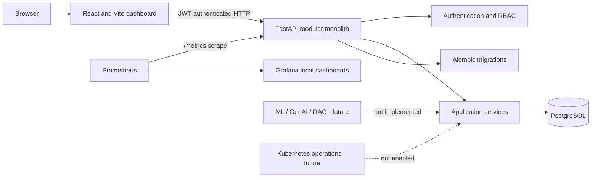

# Development of an Intelligent AIOps Framework

**Short name:** Intelligent AIOps Framework  
**Phase:** 2 — local AIOps platform (in progress)

## Project overview

This project is an academic prototype foundation for an AIOps platform. The planned system will bring infrastructure monitoring, log analysis, machine-learning anomaly and risk detection, Generative AI incident analysis, runbook retrieval, and carefully controlled operations into a single application.

Phase 1 established the web application, authentication, PostgreSQL schema, migrations, APIs, dashboard, and local Docker Compose setup. Phase 2 is extending this foundation incrementally. The current Phase 2 increments add Prometheus application metrics, a provisioned local Grafana dashboard, and an API pipeline that reads Prometheus samples, scores them with Isolation Forest, and persists detected anomalies with linked incidents. Host/container telemetry, log collection, predictive analytics, RAG, GenAI, and Kubernetes operations are not yet implemented. GCP deployment is intentionally deferred to Phase 3 and is not required.

## Problem statement

Infrastructure data and operational incidents can require engineers to correlate signals from multiple tools. This project will develop and evaluate a controlled prototype that organizes operational records and prepares a foundation for measured, evidence-based assistance.

## Objectives

- Establish a maintainable full-stack application foundation.
- Provide secure account registration, login, JWT authentication, and a role-based access-control foundation.
- Persist application data in PostgreSQL with versioned Alembic migrations.
- Provide an authenticated dashboard and initial resource, incident, and deployment APIs.
- Clearly distinguish recorded database state from illustrative chart data.
- Prepare integration boundaries for later monitoring, ML, RAG, GenAI, and approved operations work.

## Technology stack

| Area | Foundation |
|---|---|
| Frontend | React, TypeScript, Vite, Tailwind CSS, React Router, Axios, Recharts, Lucide React |
| Backend | Python 3.13, FastAPI, Pydantic, SQLAlchemy, Alembic |
| Database | PostgreSQL 17 in Compose; SQLite is available for local development and tests |
| Authentication | PyJWT bearer tokens and `pwdlib` Argon2id password hashing |
| Tests | pytest, FastAPI TestClient/httpx, Vitest, Testing Library |
| Containers | Dockerfiles and Docker Compose |

## Architecture



The backend is a modular monolith. Prometheus/Grafana application telemetry is available in Phase 2 when the local Compose services are running. Container/host telemetry, ML, GenAI, RAG, Kubernetes, and cloud services remain separate later increments. GCP deployment is intentionally deferred to Phase 3.

## Folder structure

```text
backend/
  app/
    api/routes/       # Health, authentication, dashboard, monitoring, anomaly, and admin endpoints
    core/             # Settings, JWT/password security, and role permissions
    database/         # SQLAlchemy base, engine, and session dependency
    models/           # User, project, resource, incident, deployment, audit records
    schemas/          # API request and response schemas
    services/         # Authentication and application services
  alembic/            # Versioned database schema migrations
  tests/              # Backend API and authorization tests
frontend/
  src/
    components/       # Shared layout, dashboard, and page components
    context/          # Authentication/session state
    pages/            # Login, registration, dashboard, feature placeholders
    services/         # API client and typed endpoint access
    tests/            # Frontend validation tests
ai_engine/            # Isolation Forest anomaly detection; future RAG, GenAI, and agent work
monitoring/           # Prometheus scraping and Grafana provisioning
deployment/           # Future Kubernetes and Terraform deployment work
docs/                 # Phase scope and project notes
```

## Prerequisites

- Windows 10/11 with PowerShell.
- Python 3.11 or newer (the current project was prepared with Python 3.13).
- Node.js 22 or newer and npm.
- Docker Desktop with Docker Compose v2.

## Environment setup

Run these commands from the repository root in PowerShell.

1. Create a local environment file:

   ```powershell
   Copy-Item .env.example .env
   ```

2. Generate strong local development values. The generated database password is URL-safe so Compose can construct the PostgreSQL connection URL without special-character escaping:

   ```powershell
   $dbPassword = python -c "import secrets; print(secrets.token_urlsafe(24))"
   $secret = python -c "import secrets; print(secrets.token_urlsafe(48))"
   $grafanaPassword = python -c "import secrets; print(secrets.token_urlsafe(32))"
   (Get-Content .env) -replace '^POSTGRES_PASSWORD=.*$', "POSTGRES_PASSWORD=$dbPassword" -replace '^SECRET_KEY=.*$', "SECRET_KEY=$secret" -replace '^GRAFANA_ADMIN_PASSWORD=.*$', "GRAFANA_ADMIN_PASSWORD=$grafanaPassword" | Set-Content .env
   ```

   `.env` contains local secrets and is ignored by Git. Do not copy these development values into a production environment.

## Run with Docker Compose (recommended)

From the repository root:

```powershell
docker compose up --build
```

Compose builds the backend and frontend, waits for PostgreSQL, runs Alembic migrations before starting the API, and waits for API health before starting Vite. The backend image build uses the repository root as its context so it can include the existing `ai_engine` package required by the Prometheus anomaly service; `.dockerignore` excludes local secrets and development data from that context.

- Frontend: <http://localhost:5173>
- API health: <http://localhost:8000/api/health>
- Prometheus metrics: <http://localhost:8000/metrics>
- Prometheus: <http://localhost:9090>
- Prometheus scrape targets: <http://localhost:9090/targets>
- Grafana: <http://localhost:3000> (credentials are in the local `.env`)
- Grafana dashboard: <http://localhost:3000/d/aiops-infrastructure/aiops-infrastructure>
- Swagger UI: <http://localhost:8000/docs>
- ReDoc: <http://localhost:8000/redoc>

PostgreSQL has no host-published port; only application containers can reach it on the private Compose network.
Prometheus and Grafana are bound to loopback. The configured Grafana dashboard
shows backend process and HTTP metrics only; it does not yet show host or
container resource usage.

Stop the services and retain database data:

```powershell
docker compose down
```

Remove the containers **and** the PostgreSQL data volume:

```powershell
docker compose down -v
```

`docker compose down -v` permanently deletes the local development database data. Use it only when you intend to reset the database.

Check service status and logs:

```powershell
docker compose ps
docker compose logs backend
docker compose logs postgres
docker compose logs prometheus
docker compose logs grafana
```

## Local development without Docker

The local API can use SQLite for development; migrations still manage its schema. The root `.env` file is loaded by backend settings.

From the repository root:

```powershell
python -m venv .venv
.\.venv\Scripts\Activate.ps1
python -m pip install -r backend\requirements.txt
```

If PowerShell blocks virtual-environment activation, either open a PowerShell session with an allowed execution policy or run commands with the environment's Python directly:

```powershell
.\.venv\Scripts\python.exe -m pip install -r backend\requirements.txt
```

Start the backend from the `backend` directory so Alembic locates its configuration:

```powershell
Set-Location backend
alembic upgrade head
uvicorn app.main:app --reload
```

Expected startup output includes Uvicorn listening on `http://127.0.0.1:8000`. Keep that terminal open.

In another PowerShell terminal, from the repository root:

```powershell
Set-Location frontend
npm install
$env:VITE_API_BASE_URL = "http://localhost:8000/api"
npm run dev
```

Open <http://localhost:5173>. If registration or login reports a network/CORS error, confirm the backend is listening on port 8000 and that `CORS_ORIGINS` in `.env` includes `http://localhost:5173`.

## Database migrations

Docker applies migrations automatically when the backend container starts. For local development, run from `backend`:

```powershell
alembic upgrade head
alembic current
```

The initial Phase 1 revision is `20261030_0001`; the current Phase 2 schema revision is `20261031_0002`. To create a later migration after changing models:

```powershell
alembic revision --autogenerate -m "describe the schema change"
```

Review generated migration files before applying them. Do not replace migrations with `Base.metadata.create_all()` in the application.

## Create the first administrator

Public registration always creates a Viewer account. It cannot grant an elevated role from a request. To create the initial administrator, first start the backend and apply migrations, then open a separate terminal in `backend`:

```powershell
python -m app.cli
```

Enter an administrator name, valid email, and a password of at least 12 characters. Password entry is hidden. Admin-only user listing is available at `GET /api/admin/users`; direct role-management endpoints are not implemented in Phase 1.

For the Docker Compose setup, run the interactive command from the repository root instead:

```powershell
docker compose exec backend python -m app.cli
```

## Authentication and role behavior

- `POST /api/auth/register` creates a Viewer account with an Argon2id password hash.
- `POST /api/auth/login` accepts OAuth2 form fields `username` (email) and `password`, then returns a short-lived JWT and user profile.
- `GET /api/auth/me` validates the bearer token and returns the current active user.
- New accounts cannot select their own role.
- `GET /api/admin/users` requires the Admin role and returns `403` for non-admin users.
- Dashboard, monitoring, incidents, and deployment data endpoints require a valid bearer token.

For Swagger authorization, use the OAuth2 password form with the account email as `username`, or use the returned token as a Bearer token.

## API endpoints

| Method | Endpoint | Access | Behavior |
|---|---|---|---|
| `GET` | `/api/health` | Public | Checks API and database connectivity; unavailable DB returns `503` |
| `GET` | `/metrics` | Public, Prometheus scrape | Exposes FastAPI HTTP and Python process metrics in Prometheus text format |
| `POST` | `/api/auth/register` | Public | Creates a Viewer account |
| `POST` | `/api/auth/login` | Public | Validates credentials and returns a JWT |
| `GET` | `/api/auth/me` | Authenticated | Returns the current account |
| `GET` | `/api/dashboard/overview` | Authenticated | Counts stored records; telemetry status is `false` |
| `GET` | `/api/projects` | Authenticated | Lists projects owned by the current user |
| `POST` | `/api/projects` | Authenticated | Creates a local project and records the creation in the audit table |
| `GET` | `/api/monitoring/resources` | Authenticated | Lists the current user's registered Prometheus resources |
| `POST` | `/api/monitoring/resources` | Authenticated | Registers a resource only when its Prometheus job has a healthy target |
| `GET` | `/api/anomalies` | Authenticated | Lists persisted anomalies for the current user's projects |
| `POST` | `/api/anomalies/detect` | Authenticated | Runs Isolation Forest on Prometheus samples and creates linked incidents for newly detected anomalies |
| `GET` | `/api/incidents` | Authenticated | Returns incidents for projects owned by the current user |
| `GET` | `/api/deployments` | Authenticated | Returns stored deployments or an empty list |
| `GET` | `/api/admin/users` | Admin | Lists users; other roles receive `403` |

Interactive API documentation: <http://localhost:8000/docs>.

## Database tables

The initial migration creates:

- `users`
- `projects`
- `infrastructure_resources`
- `incidents`
- `deployments`
- `audit_logs`
- `alembic_version` (migration bookkeeping)

Foreign keys, unique email constraint, status/severity enums, and lookup indexes are included in the schema. Prometheus stores high-volume scraped metrics; PostgreSQL holds application records.

## Testing and build checks

From the repository root, with the Python virtual environment active:

```powershell
pytest
```

This runs backend tests using an isolated in-memory SQLite database. It covers the API health/database check, authentication and role checks, Prometheus query handling, Isolation Forest behavior, and the anomaly-to-incident API workflow. The end-to-end API fixture uses clearly test-only synthetic Prometheus samples; it is not evidence of live monitoring behavior.

From `frontend`:

```powershell
npm install
npm test -- --run
npm run build
```

The frontend test suite covers registration form validation. The build performs TypeScript checking before bundling.

## Phase 1 foundation status

### Implemented

- React/TypeScript responsive AIOps dashboard shell and navigation.
- Actual API-backed registration, login, logout, protected routes, JWT session handling.
- FastAPI modular monolith and OpenAPI documentation.
- Argon2id password hashing and expiring JWT access tokens.
- Viewer-only self-registration and Admin-only user listing.
- SQLAlchemy models, PostgreSQL connection configuration, Alembic initial migration.
- Health, auth, dashboard, monitoring-resource, anomaly, incident, deployment, and admin APIs.
- Database-backed empty-state dashboard summaries.
- Explicitly labelled illustrative CPU/memory chart data.
- Dockerfiles and Compose stack with database health checks, private PostgreSQL network, persistent volumes, and migration-on-start.
- Backend and frontend automated tests.

## Phase 2 status

- Prometheus scrapes FastAPI metrics at `/metrics`, including HTTP request counts/latency and Python process CPU/memory metrics.
- Grafana provisions a local Prometheus data source and an Infrastructure Overview dashboard.
- Authenticated users can create local projects, associate a project resource with a healthy Prometheus job, and trigger an Isolation Forest analysis of observed samples.
- Newly detected samples are persisted as anomalies and linked medium-severity incidents. Duplicate detections at the same resource/timestamp do not create duplicate incidents.
- The anomaly score is the negated Isolation Forest decision function, not a probability. This detector labels observed samples; it is not a future-risk predictor.
- The current job exposes backend process/application metrics only. Host/container CPU, memory, disk, and network metrics, log ingestion, predictive analytics, RAG, GenAI, and controlled Kubernetes operations are not yet implemented.
- Unit/API tests use test-only synthetic samples; live operation requires real Prometheus history and is not demonstrated by those fixtures.
- Prometheus and Grafana are local Compose services, persist their data, and bind their web interfaces to loopback.
- GCP deployment is intentionally deferred to Phase 3; no GCP account, billing, or credentials are required.

## Roadmap

1. Verify the applicable VTU scheme and department report requirements.
2. Extend local monitoring to containers and application health.
3. Add log collection and incident workflows.
4. Define labelled time-series data and evaluate anomaly/risk models.
5. Add evidence-grounded LLM analysis and runbook retrieval.
6. Add approval-gated test-environment actions and audit verification.
7. Implement GCP deployment only in Phase 3 after local testing and cost review.
